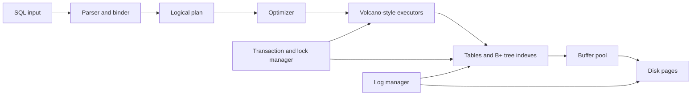

# HuaDB Relational Kernel

An implementation-focused relational database engine in modern C++17. The
project follows the path from SQL planning through query execution and
optimization down to page management, buffer replacement, recovery,
transactions, and B+ tree indexing.

The codebase extends the open-source
[HuaDB educational database framework](https://github.com/thu-db/huadb).
Upstream infrastructure such as the SQL parser, binder, catalog, and query
planner is retained. The implementation work documented here focuses on the
storage engine, recovery manager, transaction layer, execution operators, query
rewrites, join ordering, and index integration.

> **Repository status.** This repository contains implementation code produced
> against a teaching database framework. The upstream project asks that student
> solutions not be published in public repositories. Keep this repository
> private unless redistribution is explicitly authorized.

## System capabilities

- **Page and table storage:** slotted table pages, linked page chains, record
  insertion, deletion, update, and sequential scans.
- **Buffer management:** page-pinning-aware buffer pools and LRU replacement.
- **Crash recovery:** write-ahead log records, LSN propagation, transaction
  rollback, checkpoints, dirty-page tracking, and analyze/redo/undo recovery.
- **Transactions:** snapshot-based visibility, isolation-level behavior,
  shared/exclusive/intention locks, lock upgrades, and lock release.
- **Query execution:** limit, sort, nested-loop join, and merge join operators.
- **Query optimization:** predicate normalization, filter and join predicate
  pushdown, index selection, and cardinality-aware greedy join ordering.
- **Indexing:** B+ tree bulk construction, page hierarchy management, point and
  range search, index scans, and row-ID union scans.

## Architecture



The execution layer consumes a tree of physical operators. Storage and index
operators read through the buffer pool, while transaction state controls record
visibility and lock acquisition. Log records carry LSNs and previous-LSN links
for rollback and recovery.

## Component map

| Milestone branch | Component | Implementation focus |
| --- | --- | --- |
| [`milestone-1-storage`](../../tree/milestone-1-storage) | Storage and buffers | LRU policy, slotted-page records, insert/delete/update, page chains, and table scans |
| [`milestone-2-recovery`](../../tree/milestone-2-recovery) | Recovery | Log append and flush, LSN chains, rollback, checkpoints, and ARIES-style analyze/redo/undo |
| [`milestone-3-transactions`](../../tree/milestone-3-transactions) | Transactions | Snapshot visibility, isolation behavior, shared/exclusive/intention locks, compatibility, and upgrades |
| [`milestone-4-execution`](../../tree/milestone-4-execution) | Execution | Limit, ordering, nested-loop join, and merge join |
| [`milestone-5-optimizer`](../../tree/milestone-5-optimizer) | Optimization | Predicate normalization, predicate pushdown, and cardinality-aware greedy join reordering |
| [`milestone-6-indexing`](../../tree/milestone-6-indexing) | Indexing | B+ tree construction, search, pagination, scans, index selection, and execution integration |

The milestone branches are cumulative and point to the original implementation
commits. The `portfolio` branch expands `milestone-6-indexing` with this
overview, architecture documentation, build fixes, and continuous integration
while preserving all original commits.

## Engineering highlights

### Snapshot-aware visibility

Record iteration checks insert and delete transaction IDs against the current
snapshot, the isolation level, and the command ID. This supports repeatable-read
and read-committed behavior while also addressing visibility anomalies such as
the Halloween problem and write skew.

### Recovery from explicit log state

The log manager maintains an active transaction table, a dirty page table, a
next-LSN counter, and a flushed-LSN boundary. Transactions generate begin,
insert, delete, new-page, commit, rollback, and checkpoint records. Recovery
uses these structures for analysis, redo, and undo instead of assuming that all
pages or logs are already durable.

### Cost-aware join ordering

The optimizer flattens nested-loop joins, preserves only predicates that can be
evaluated at each join boundary, estimates table cardinalities from catalog
statistics, and grows a join tree greedily using estimated output cardinality.

### Bulk B+ tree construction

Index construction scans and sorts heap records by composite `(key, heap RID)`,
builds leaf pages in key order, promotes the minimum key of each child into the
internal level, links sibling leaves, and writes the final root to the index
metadata page.

## Build

The full command-line shell and SQL test harness target Linux/macOS because they
use POSIX process and terminal APIs.

Requirements:

- CMake 3.15 or newer
- A C++17 compiler
- GNU Make

```bash
git clone <private-repository-url>
cd <repository-name>

make debug

# Run the SQL logic tests for every implementation stage.
make lab6
```

With CMake 4.x, newer policy behavior may require:

```bash
cmake -S . -B build/debug \
  -DCMAKE_BUILD_TYPE=Debug \
  -DCMAKE_POLICY_VERSION_MINIMUM=3.5
cmake --build build/debug
```

## Test coverage

The repository contains 35 SQL logic tests across storage, recovery,
transactions, execution, and optimization, plus structural B+ tree verification
inputs. The configured GitHub Actions workflow builds the project and runs the
full `lab0` through `lab6` SQL suite on Ubuntu.

The core `huadb` library was also compiled locally with GCC 14 during portfolio
validation. The complete shell and SQL test executable require a POSIX
environment and are covered by CI.

## Code review entry points

- [`src/table/table_page.cpp`](src/table/table_page.cpp): slotted-page record
  layout and mutation.
- [`src/storage/lru_buffer_strategy.cpp`](src/storage/lru_buffer_strategy.cpp):
  page replacement.
- [`src/log/log_manager.cpp`](src/log/log_manager.cpp): transaction logging and
  recovery.
- [`src/table/table_scan.cpp`](src/table/table_scan.cpp): snapshot-aware record
  visibility.
- [`src/transaction/lock_manager.cpp`](src/transaction/lock_manager.cpp):
  multigranularity lock compatibility and upgrades.
- [`src/optimizer/`](src/optimizer/): normalization, pushdown, index selection,
  and join ordering.
- [`src/index/btree_index.cpp`](src/index/btree_index.cpp): B+ tree construction
  and search.

The deeper design notes are in
[Engine Architecture](docs/ENGINE_ARCHITECTURE.md).

## Project scope

This is a single-node teaching database engine. It does not implement
distributed execution, replication, a production-grade SQL surface, or a full
optimizer cost model. The strongest part of the project is the cross-layer
implementation from page-level storage and transactional correctness to query
execution and indexing.

## Provenance and license

HuaDB is an open-source educational database project. Its upstream MIT license
and commit history are retained. This portfolio branch adds documentation and
small build-portability fixes; it does not claim ownership of upstream modules.
